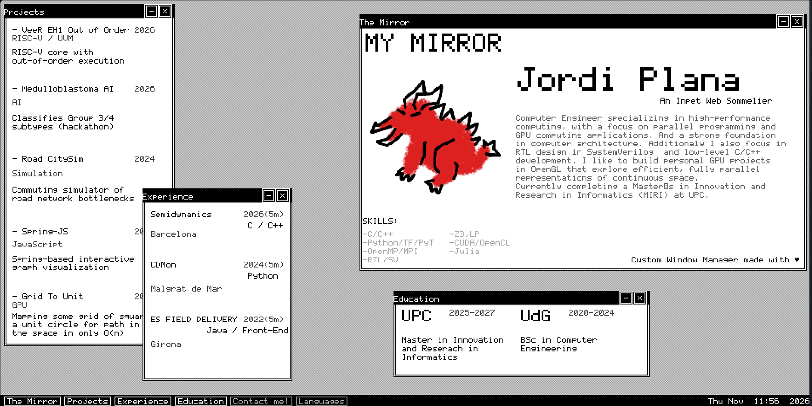

# LossyOS

A tiny, dependency-free window manager that runs entirely in the browser. Windows, text and layout are drawn by hand on an HTML `<canvas>`, with a second WebGL canvas behind it for the animated background. The look is inspired by the Macintosh System 1.0.



Right now it's set up as an interactive [portafolio](https://lossymandias.com/).: each "app" window is a section of a CV.


## Features

- **Pure canvas UI**: no DOM widgets, no framework, no build step. Everything is drawn with the 2D context.
- **Minimal window manager**: windows with title bars, positions, sizes and open/closed state.
- **Declarative layout tree**: window contents are composed from small layout nodes that split or pad a window's area.
- **Bitmap text rendering**: custom `drawBitmapText` / `measureBitmapText` for a crisp, pixel-perfect System 1.0 look.
- **WebGL background**: a second, separate canvas renders the backdrop and runs independently of the UI layer.
- **Runs anywhere**: static files only, so you can host it on GitHub Pages or any static server.

## How it works

The page stacks two canvases:

| Canvas | Script | Purpose |
|---|---|---|
| `#canvasBack` | `index_back.js` | WebGL background |
| `#canvas` | `index.js` | 2D canvas: windows, layout and text |

Keeping them separate means the UI can redraw on input without touching the shader, and the background can animate at its own pace.

### Window definitions

Windows are described as plain data in `gAttrDefaultWin`:

```js
{
  sstrdId: "",
  title: "Projects",
  runContent: "wEProjects",   // content/app that fills the window
  strPos: [5/960, 5/461],     // initial position, normalized to a 960x461 reference
  strSize: [200, 400],        // initial size in pixels
  strState: true              // open on startup?
}
```

To add a window, add an entry to this array and provide a matching content definition for `runContent`.

### Layout nodes

The content of a window is a tree of `ord*` nodes. Each node receives the window's area (`EX_winA`) and returns its children together with the sub-areas they should occupy. Leaves do the actual drawing.

**Containers**

| Node | Description |
|---|---|
| `ordSingleNode(child, padding)` | Wraps one child and insets it by `[x, y]` padding on each side. |
| `ordColumnsV(children, prop)` | Splits the area into two side-by-side panes. `prop` (0–1) is the left pane's share of the width. |
| `ordColumnsH(children, prop)` | Splits the area into two stacked panes. `prop` (0–1) is the top pane's share of the height. |

**Leaves**

| Node | Description |
|---|---|
| `ordColor(color)` | Fills its area with a solid color. |
| `ordText(text, size, color)` | Draws multi-line bitmap text (splits on `\n`). |
| `ordImage(base64)` | Draws an image from a base64 string or `data:` URL. |

Nodes nest freely, so a layout looks like this:

```js
new ordSingleNode(
  new ordColumnsV([
    new ordText("Hello, world", 2, "#000"),
    new ordImage(myBase64Png)
  ], 0.6),
  [8, 8]
);
```

## Running locally

ES modules require a server, so opening `index.html` directly from disk won't work. Use any static server:

```bash
# Python
python3 -m http.server 8000

# or Node
npx serve .
```

Then open `http://localhost:8000`.

## Project structure

```
.
├── index.html       # Two stacked canvases + module scripts
├── style.css        # Canvas positioning
├── index.js         # Window manager, layout tree, 2D rendering
├── index_back.js    # WebGL background
└── ...
```


## Roadmap

- [ ] Dragging, focusing and closing windows
- [ ] Window resizing
- [ ] Menu bar and desktop icons
- [ ] Scrollable content
- [ ] Touch support

## Credits

Inspired by the original Macintosh System 1.0 (1984) interface.